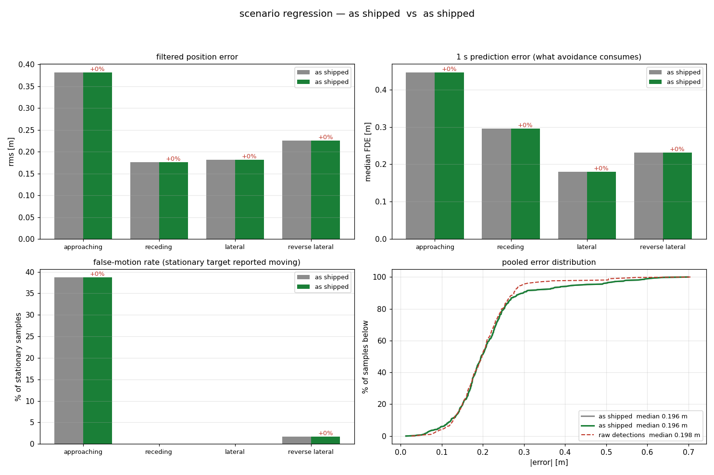
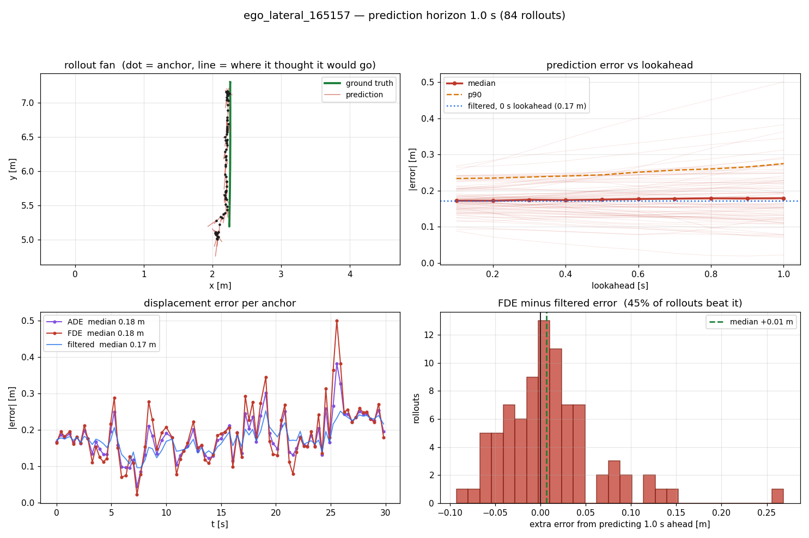
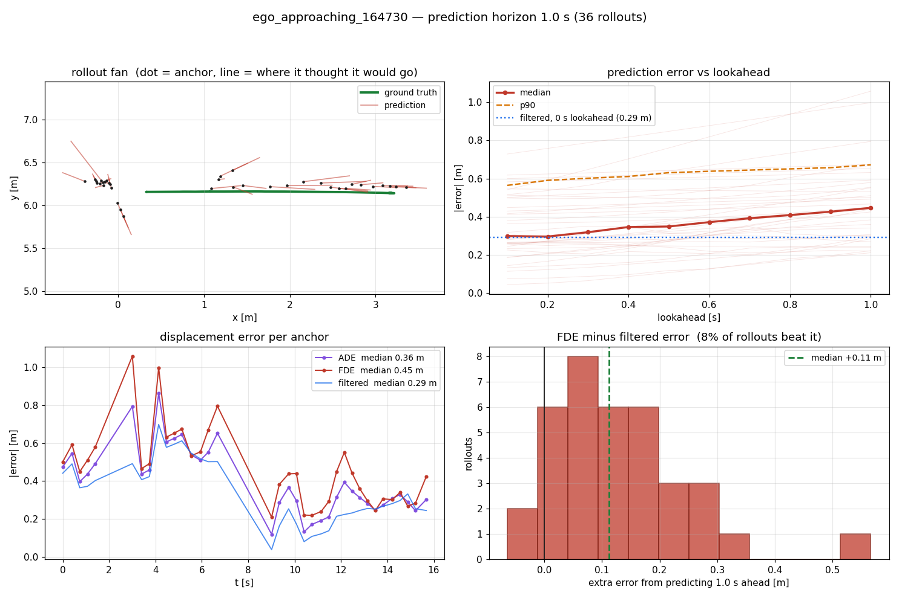
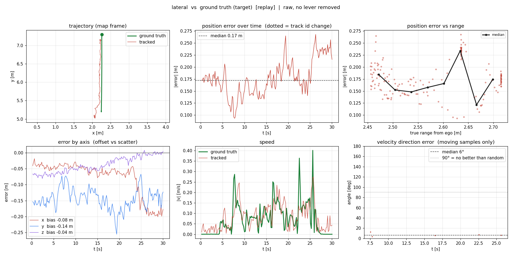
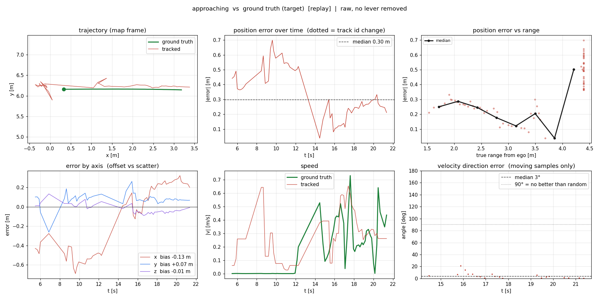

# KF Object Tracking

A ROS 2 package that tracks moving objects in 3-D space using a **Kalman Filter with a Constant Velocity model**. It consumes raw detections from any perception system, assigns persistent IDs, estimates velocity, and publishes rich prediction outputs — including predicted trajectories with correct object sizes — for consumption by planners and controllers.

On the car it sits in the middle of the chain:

```
camera -> detectnet -> object_projection_3d -> kf_object_tracker -> pure_persuit_node
                       (3D boxes, map frame)   (ids + velocity)     (drives around them)
```

A built-in **dummy objects publisher** with sinusoidally varying speeds lets the entire pipeline be exercised in simulation without any real sensor, and `tools/` holds an offline evaluation harness that scores any change against recorded bags without touching the car.

**Read [What the numbers say](#what-the-numbers-say) before tuning anything.** The filter does not improve position accuracy, and a lot of obvious-looking tuning has already been tried and measured.

---

## Table of Contents

1. [Core Ideas](#core-ideas)
2. [Architecture Overview](#architecture-overview)
3. [Nodes](#nodes)
   - [kf_object_tracker](#kf_object_tracker)
   - [dummy_objects_publisher](#dummy_objects_publisher)
   - [tracker_visualizer](#tracker_visualizer)
4. [Published Topics](#published-topics)
5. [Parameters](#parameters)
6. [RViz2 Visualization](#rviz2-visualization)
7. [Launch Files](#launch-files)
8. [Package Dependencies](#package-dependencies)
9. [Building and Running](#building-and-running)
10. [Evaluation Harness](#evaluation-harness)
11. [Evaluation Results](#evaluation-results)
12. [What the Numbers Say](#what-the-numbers-say)

---

## Core Ideas

### 1. Kalman Filter — Constant Velocity Model

Each tracked object is represented by a 6-dimensional state vector:

```
x = [x,  y,  z,  vx,  vy,  vz]
```

The **state transition** (predict step) advances position by velocity × dt:

```
F = | I₃  dt·I₃ |     Q = discrete white-noise acceleration, built from q_accel
    | 0₃   I₃  |
```

`dt` is the **real elapsed time between detection message stamps**, not a fixed
constant. The detection rate on this pipeline swings between 0.6 and 10 Hz, and a
filter told 0.1 s while a full second of motion elapsed attributes the whole
displacement to a tenth of the time — inflating every velocity by
`dt_real / dt_assumed`. The `dt` parameter is only a fallback for the first
message; `dt_max` caps a single huge gap.

The **measurement model** observes only position (x, y, z):

```
H = [I₃ | 0₃]     R = diag(r_diag)
```

After each detection message arrives the filter runs two steps:
- **Predict** — rolls the state forward in time, growing covariance by Q
- **Update** — fuses the matched detection measurement, shrinking covariance via the Kalman gain

Because velocity is part of the state, the filter automatically estimates how fast each object is moving from position-only measurements. This estimated velocity is what drives all future-path predictions.

### 2. Data Association — Greedy Nearest-Neighbour

Every frame the predicted positions of existing tracks are compared against incoming detections using **pairwise Euclidean distance**. A greedy algorithm iterates over track–detection pairs sorted by ascending distance and commits each pair if:
- Both are still unassigned
- Distance ≤ `max_dist` threshold

Unmatched detections spawn new tracks; unmatched tracks increment a miss counter. This is deliberately simple and computationally cheap — suitable for sparse detection lists (< ~50 objects) where Hungarian assignment adds no accuracy benefit.

### 3. Class Filtering

Before association, incoming detections are filtered by `target_classes` (a
list). Only detections whose `results[0].hypothesis.class_id` appears in that
list are considered. The default is `['person', 'car']`.

Detections arriving in a frame other than `expected_frame` (default `map`) are
dropped wholesale. The upstream localizer silently falls back to publishing in
the camera-optical frame when its TF lookup fails, and tracking camera-relative
positions as if they were map-frame would corrupt every velocity that
pure_pursuit then steers by.

### 4. Track Lifecycle

```
New detection  →  Tentative track  →  Confirmed track  →  Coasting  →  Retired  →  Gone
                  (hits < min_hits)    (hits ≥ min_hits)   (unmatched)  (id kept)
```

- A track is **tentative** until matched `min_hits` times. Only confirmed tracks
  are published downstream, so a one-frame false detection never reaches the
  planner.
- A track is **deleted** after `max_coast_time` **seconds** unmatched — not a
  frame count. Frame counts are meaningless when the input rate varies 16×:
  10 missed frames is 1 s at the design rate but 16 s at the rate actually
  measured, long enough for a track to coast metres away on a stale velocity.
- A deleted track's **id is remembered** for `max_id_retention` seconds. If an
  object reappears within `reid_max_dist` of where it was lost, and its class
  agrees, it reclaims its old id instead of being issued a new one. Detection
  gaps are the dominant failure on this pipeline; across 22 measured gaps
  (longest 4.34 s) the object had moved only 0.01–0.77 m, so its last known
  position identifies it reliably on return.
- Ids are otherwise **monotonically increasing** and never reused in a session.

### 5. Future-Path Prediction

Once a track is confirmed, its predicted trajectory is computed by **open-loop Constant Velocity propagation**:

```
x_pred(i) = x_current + vx × predict_dt × i
y_pred(i) = y_current + vy × predict_dt × i
z_pred(i) = z_current + vz × predict_dt × i
```

for `i = 0 … predict_steps`. When an object accelerates the velocity estimate grows and the predicted path stretches further ahead; when it decelerates the path shortens — directly visible in RViz2.

### 6. Object Size in Every Predicted Step

The last known **bounding box dimensions** (`bbox.size.x/y/z`) are stored on the track and copied explicitly into every `Detection3D` in the predicted-path array. Size values are copied field-by-field (not by reference) to prevent ROS 2 message recycling from silently zeroing them. A non-zero fallback is applied so downstream planners always receive a physically meaningful collision envelope.

### 7. Velocity Embedded in Tracked Objects

Each `Detection3D` on `/tracked_objects` carries the KF-estimated velocity in a non-standard slot:

```
results[0].hypothesis.class_id   →  object class  (e.g. "person")
results[0].pose.pose.position     →  (vx, vy, vz)  map-frame velocity in m/s
```

This lets downstream planners (DWA, TTC, pure-pursuit) read both the object class and its velocity without subscribing to an extra topic.

### 8. History Trail

Each confirmed track maintains a `deque` of its last `history_len` KF-estimated positions in the visualizer node. This records the **actual path the tracker believes the object took**, including any dead-reckoning during brief missed frames. The trail is published as a `MarkerArray` LINE_STRIP.

---

## Architecture Overview

```
[Sensor / Dummy Publisher]
        │  vision_msgs/Detection3DArray
        │  /objects_in_map_frame
        ▼
┌──────────────────────────┐
│   kf_object_tracker      │  ← tracking logic only
│                          │
│  ① Filter by class       │
│  ② Predict all tracks    │
│  ③ Associate             │
│  ④ Update matched        │
│  ⑤ Increment misses      │
│  ⑥ Spawn new tracks      │
│  ⑦ Prune dead tracks     │
│  ⑧ Publish data topics   │
└──────────────────────────┘
        │
        ├─ /tracked_objects                       ← current positions + velocity (planner input)
        ├─ /tracked_objects/predicted_path_array  ← all future steps with size (planner input)
        ├─ /tracked_objects/predicted_pose_array  ← geometry_msgs/PoseArray
        ├─ /tracked_objects/predicted_snapshots   ← Detection3DArray per timestep
        └─ /tracked_objects/nav_path/track_<id>   ← nav_msgs/Path per track
        │
        ▼
┌──────────────────────────┐
│   tracker_visualizer     │  ← visualization only
│                          │
│  Maintains history deques│
│  Builds all MarkerArrays │
└──────────────────────────┘
        │
        ├─ /tracked_objects/bounding_boxes               ← RViz2 current-position cubes
        ├─ /tracked_objects/history                      ← RViz2 past-position trail
        ├─ /tracked_objects/predicted_paths              ← RViz2 LINE_STRIP + labels
        └─ /tracked_objects/predicted_path_array/markers ← RViz2 CUBE_LIST footprints
```

---

## Nodes

### kf_object_tracker

The main tracking node. Subscribes to raw detections in the map frame, filters by `target_classes`, and publishes all tracking outputs on every detection callback.

**Source:** `kf_object_tracking/kf_object_tracker.py`

Key classes:

| Class | Purpose |
|---|---|
| `KalmanFilter` | 6-DOF CV Kalman filter (predict + update) |
| `Track` | Wraps a KalmanFilter with lifecycle state: `misses`, `hits`, `bbox_size`, `class_id` |
| `associate()` | Greedy nearest-neighbour data association |
| `KFObjectTrackerNode` | ROS 2 node — orchestrates the full tracking pipeline |

---

### dummy_objects_publisher

Publishes synthetic `Detection3DArray` messages so the tracker can be fully exercised without a real sensor. Objects follow analytically integrated trajectories whose **speed varies sinusoidally**, making velocity changes and predicted-path length changes clearly visible in RViz2. All detections are published with `class_id = 'person'`.

**Source:** `kf_object_tracking/dummy_objects_publisher.py`

**Speed model:**

```
v(t) = v_base × (1 + amp × sin(freq × t))
s(t) = v_base × (t + amp/freq × (1 − cos(freq × t)))   ← exact integral, no drift
```

| Object | Scenario | Speed range | Cycle period | Extra behaviour |
|---|---|---|---|---|
| Linear   | 1 | 0.5 → 4.5 m/s | ~12.6 s | Straight along X |
| Circular | 2 | 0.15 → 0.85 rad/s | ~10.5 s | Circle r=5 m around (0, 8) |
| Diagonal | 3 | 0.45 → 3.15 m/s | ~15.7 s | 30° bearing |
| Zigzag   | 4 | 0.4 → 3.6 m/s | ~14 s | Lateral sway amplitude also varies; disappears 10 s every 30 s to test track lifecycle |

**Parameters:**

| Parameter | Default | Description |
|---|---|---|
| `publish_rate` | `10.0` Hz | Publish frequency; must match tracker `dt`. |
| `noise_std` | `0.05` m | Gaussian position noise standard deviation. |
| `frame_id` | `'map'` | `header.frame_id` for published detections. |
| `scenario` | `0` | `0` = all four objects; `1`–`4` = individual scenarios. |

---

### tracker_visualizer

Subscribes to the data topics published by `kf_object_tracker` and builds all RViz2 markers. Keeps track history internally as `deque` buffers keyed by track ID, and cleans up buffers when tracks disappear.

**Source:** `kf_object_tracking/tracker_visualizer.py`

---

## Published Topics

### Tracker outputs

| Topic | Type | Description |
|---|---|---|
| `/tracked_objects` | `vision_msgs/Detection3DArray` | Confirmed tracks at current KF-estimated position. `Detection3D.id` = persistent track ID. `results[0].pose.pose.position` = `(vx, vy, vz)` velocity from KF. |
| `/tracked_objects/predicted_path_array` | `vision_msgs/Detection3DArray` | **Primary planner input.** All confirmed tracks × all future steps in one flat message. Each `Detection3D`: `id`=track ID, `header.stamp`=predicted future time, `bbox.center.position`=predicted position, `bbox.size`=object dimensions (guaranteed non-zero). |
| `/tracked_objects/predicted_snapshots` | `vision_msgs/Detection3DArray` | One message per future timestep — all tracks at step 0, then step 1, etc. |
| `/tracked_objects/predicted_pose_array` | `geometry_msgs/PoseArray` | All tracks' future waypoints flattened. Yaw derived from estimated velocity. |
| `/tracked_objects/nav_path/track_<id>` | `nav_msgs/Path` | One nav-path topic per confirmed track, with future timestamps. Created/destroyed with the track. |
| `/tracked_objects/predicted_paths` | `visualization_msgs/MarkerArray` | LINE_STRIP future path + floating `ID: N  X.X m/s` speed label per track. |
| `/tracked_objects/bounding_boxes` | `visualization_msgs/MarkerArray` | Semi-transparent CUBE at each track's current position, sized from `bbox_size`. |
| `/tracked_objects/history` | `visualization_msgs/MarkerArray` | LINE_STRIP of the last `history_len` KF positions per track. |
| `/tracked_objects/predicted_path_array/markers` | `visualization_msgs/MarkerArray` | **RViz2 render of `predicted_path_array`.** CUBE_LIST (one per track) where each cube = object footprint at one future step. Alpha fades solid → transparent with time. Thin spine LINE_STRIP overlaid for readability. |

### Dummy publisher output

| Topic | Type | Description |
|---|---|---|
| `/objects_in_map_frame` | `vision_msgs/Detection3DArray` | Synthetic detections with varying speed for testing. All detections have `class_id = 'person'`. |

---

## Parameters

All parameters live in `config/params.yaml`, which carries the measurement
behind each default. Defaults below are what the node declares.

**`kf_object_tracker` namespace:**

| Parameter | Default | Description |
|---|---|---|
| `dt` | `0.1` s | **Fallback only.** Used for the first message and whenever the measured interval is unusable. Normal steps use real elapsed time between message stamps. |
| `dt_max` | `1.0` s | Caps one predict step, so a multi-second dropout cannot fling every track across the map at once. |
| `max_dist` | `2.0` m | Maximum distance for a detection to associate to an existing track. |
| `max_coast_time` | `1.0` s | Seconds a track may coast unmatched before deletion. Replaces the old frame-count limit. |
| `max_id_retention` | `3.0` s | Seconds a deleted track's id stays claimable by a reappearing object. `0` disables id re-acquisition. |
| `reid_max_dist` | `1.5` m | How far a new detection may be from a retired track's last position and still inherit its id. |
| `min_hits` | `1` | Matches before a track is published downstream. |
| `predict_steps` | `20` | Future waypoints published. Lookahead = `predict_steps × predict_dt`. |
| `predict_dt` | `0.1` s | Time between predicted waypoints. |
| `q_accel` | `0.5` m²/s³ | Process noise spectral density — unmodelled acceleration the constant-velocity model absorbs. Raise if tracks lag manoeuvring targets, lower if they look jittery. |
| `r_diag` | `[0.03, 0.03, 0.0015]` | Measurement noise variance per axis (m²), measured as detection scatter about ground truth. See the note below before changing. |
| `size_alpha` | `0.3` | EMA weight on the box extent. Raw per-frame size jitters ~15% of car length, and pure_pursuit sizes its clearance corridor from it, so a jittering box means a jittering safety margin. `1.0` restores take-latest. |
| `score_weight_r` | `true` | Inflate R for low-confidence detections. Measured `fg_prob` spans 0.48–0.97. |
| `target_classes` | `['person', 'car']` | Only these `class_id` values are tracked. |
| `expected_frame` | `'map'` | Detections in any other frame are dropped. |

> **Retuning `r_diag` is unlikely to pay.** It was swept over shape and
> magnitude across four scripted runs: ×1 to ×32 inflation, plus ray-aligned
> variants using the genuinely measured anisotropy (σ 0.137 m along the camera
> ray vs 0.060 m across it). Everything landed at 0.237–0.256 m rms against the
> default's 0.237. Inflating R does halve the false-motion rate (10% → 5%) but
> only by trading phantom velocity for lag.

**`tracker_visualizer` namespace:**

| Parameter | Default | Description |
|---|---|---|
| `history_len` | `50` | Past positions kept per track. At 10 Hz this is 5 s of trail. |
| `marker_lifetime` | `3.0` s | RViz marker lifetime. Must exceed the detection interval or markers flicker between updates. |

---

## RViz2 Visualization

The config file `config/tracker.rviz` pre-configures five displays in a top-down orthographic view:

| Display name | Topic | What it shows |
|---|---|---|
| **Bounding Boxes** | `.../bounding_boxes` | Semi-transparent cube at each object's current KF-estimated position, sized to its actual dimensions. |
| **History Trails** | `.../history` | Where the object has been — last `history_len` KF positions as a coloured line. |
| **Predicted Footprints** | `.../predicted_path_array/markers` | Where the object **will be** at each future timestep, drawn at actual object size. Opaque = imminent, transparent = far future. The spine line connects cube centres. |
| **Predicted Paths** | `.../predicted_paths` | Thin LINE_STRIP overlay of the predicted trajectory with floating `ID: N  X.X m/s` speed label. |
| **Predicted Poses** | `.../predicted_pose_array` | Flat arrows at each future waypoint showing heading derived from estimated velocity. |

### Reading the Predicted Footprints display

```
█████  ████  ███  ██  █  ░  ░  ░  ░  ░
 now  +0.1s +0.2s  ...              +2.0s
solid ────────────────────── transparent
```

- **Cubes spread far apart** → object is moving fast, long lookahead
- **Cubes clustered near current position** → object is decelerating or nearly stopped
- **Cube size** → the actual physical footprint the planner must avoid

Each unique track has its own persistent colour generated from a golden-ratio hue sequence so colours never collide even with many simultaneous objects.

---

## Launch Files

| File | What it starts |
|---|---|
| `launch/simulation.launch.py` | **Full simulation**: dummy publisher + tracker + visualizer + RViz2. Use `scenario:=<1-4>` to select a single trajectory pattern. |
| `launch/tracker.launch.py` | Tracker + visualizer (bring your own detections on `/objects_in_map_frame`). |
| `launch/dummy_objects.launch.py` | Dummy publisher + tracker + visualizer (no RViz2). |

**Run the full simulation:**

```bash
ros2 launch kf_object_tracking simulation.launch.py
```

**Select a single scenario:**

```bash
ros2 launch kf_object_tracking simulation.launch.py scenario:=2   # circular only
```

**Override tracker parameters at launch:**

```bash
ros2 launch kf_object_tracking simulation.launch.py \
    params_file:=/path/to/my_params.yaml
```

---

## Package Dependencies

| Dependency | Used for |
|---|---|
| `rclpy` | ROS 2 Python client library |
| `vision_msgs` | `Detection3DArray`, `Detection3D` |
| `visualization_msgs` | `MarkerArray`, `Marker` |
| `nav_msgs` | `Path` per track |
| `geometry_msgs` | `PoseArray`, `PoseStamped`, `Point` |
| `std_msgs` | `ColorRGBA` |
| `builtin_interfaces` | `Duration` for marker lifetimes |
| `numpy` | Matrix operations in the Kalman filter |

---

## Building and Running

```bash
# Clone into your ROS 2 workspace
cd ~/ros2_ws/src
git clone <repo-url> kf_object_tracking

# Install dependencies
cd ~/ros2_ws
rosdep install --from-paths src --ignore-src -r -y

# Build
colcon build --packages-select kf_object_tracking
source install/setup.bash

# Run full simulation with RViz2
ros2 launch kf_object_tracking simulation.launch.py
```

To connect to a real perception pipeline, remap the input topic:

```bash
ros2 launch kf_object_tracking tracker.launch.py \
    --ros-args -r /objects_in_map_frame:=/your/detection_topic
```

To override the tracked classes:

```bash
ros2 launch kf_object_tracking tracker.launch.py \
    --ros-args -p kf_object_tracker:target_classes:="['car']"
```

---

## Evaluation Harness

`tools/` scores any tracker change against recorded bags — no car, no driving.
Everything below runs offline and reuses the node's own estimation classes, so
what is scored is what will actually run.

| Tool | Answers |
|---|---|
| `eval_lib.py` | Shared primitives: bag reading, interpolation, ground truth, camera visibility gate |
| `evaluate_tracker.py` | Position/velocity accuracy, CLEAR-MOT (id switches, fragmentation, recall), A/B, regression over all bags |
| `predict_eval.py` | ADE/FDE over a prediction horizon — the number avoidance actually consumes |
| `scenario_regression.py` | A/B across the four scripted scenarios, with plots |
| `plot_eval.py` | Six-panel per-run figure plus CSV |
| `compare_scenarios.py` | Overlays several runs to separate range effects from viewing-angle effects |
| `simulate_scenarios.py` | Synthetic detections at known ground truth |
| `live_eval.py` | Scores a run as it happens, via the domain bridge |
| `compare_kf_vs_mocap.py` | Live node comparing tracker output against mocap |

```bash
# score one run
python3 tools/evaluate_tracker.py <ego_bag> <target_bag>

# did my change help? same input, two configs
python3 tools/evaluate_tracker.py <ego> <tgt> --ab "q_accel=0.5" "q_accel=0.1"

# every recorded pair, one table
python3 tools/evaluate_tracker.py --regression

# the four scripted scenarios, with plots
python3 tools/scenario_regression.py --a "q_accel=0.5" --b "q_accel=0.1"

# how good is the 1 s prediction that avoidance uses?
python3 tools/predict_eval.py --regression
```

Ground truth is the target car's own `/kinematic_state`, recorded on its own ROS
domain. `config/target_gt_bridge.yaml` bridges it onto the ego's domain for live
scoring.

---

## Evaluation Results

Full numeric report: [`docs/full_evaluation_report.txt`](docs/full_evaluation_report.txt).
Figures and CSVs are regenerated into `~/ros2_ws/eval_results/` by the commands
in [Evaluation Harness](#evaluation-harness); the ones below are copied into the
repo so they render here.

### Summary across the four scripted scenarios



| Scenario | n | raw det. | filtered | 1 s FDE | false motion |
|---|---|---|---|---|---|
| approaching | 69 | 0.325 m | 0.382 m | 0.446 m | 39% |
| receding | 63 | 0.179 m | 0.177 m | 0.295 m | 0% |
| lateral | 169 | 0.182 m | 0.181 m | 0.179 m | 0% |
| reverse lateral | 126 | 0.226 m | 0.225 m | 0.231 m | 2% |
| **pooled** | **427** | **0.217 m** | **0.237 m** | **0.229 m** | **10%** |

*false motion* = share of samples where the target is stationary
(< 0.05 m/s truth) but the tracker reports it moving faster than 0.25 m/s.

### Pooled — every recorded run

`pos rms` is filtered position error; `MOTA` is the CLEAR-MOT summary over
ground-truth objects inside the camera envelope.

| Bag | n | pos rms | vel rms | dir med | ids | IDsw | recall | MOTA |
|---|---|---|---|---|---|---|---|---|
| ego_lateral_165157 | 180 | 0.180 | 0.075 | 6.2° | 1 | 0 | 100.0% | 98.9% |
| ego_receding_164958 | 63 | 0.177 | 0.329 | 9.2° | 1 | 0 | 74.7% | 69.6% |
| ego_reverselateral_165310 | 126 | 0.225 | 0.120 | 7.0° | 1 | 0 | 100.0% | 100.0% |
| ego_approaching_164730 | 69 | 0.382 | 0.223 | 3.5° | 1 | 0 | 61.6% | 56.2% |
| ego_162135 | 929 | 0.327 | 0.725 | 7.2° | 1 | 0 | 96.8% | 81.9% |
| ego_7020446 | 471 | 0.349 | 0.419 | 6.6° | 4 | 3 | 92.0% | 89.5% |
| ego_8021906 | 615 | 0.416 | 0.481 | 9.1° | 6 | 5 | 92.8% | 87.9% |
| ego_4232752 | 168 | 0.382 | 0.774 | 47.6° | 4 | 3 | 96.6% | 81.0% |
| ego_6002640 | 153 | 0.381 | 1.104 | 104.5° | 2 | 1 | 99.3% | 78.7% |
| ego_3215227 | 30 | 0.555 | 1.448 | 88.5° | 2 | 5 | 96.7% | 6.7% |
| avoid_3133844 | 41 | 1.141 | 0.560 | 13.1° | 3 | 1 | 38.1% | 26.2% |
| avoid_2131801 | 62 | 1.550 | 0.625 | 11.8° | 1 | 0 | 45.6% | 31.1% |

Position error spans **0.18–1.55 m, an 8× spread**, and it tracks the *detector*,
not the filter. The two worst rows are the avoidance runs that crashed.

### Prediction horizon — what avoidance actually consumes

`pure_persuit_node` steers around where an obstacle will be in 1 s, so this is
the number that decides whether the car hits it.

| | filtered (0 s) | ADE | FDE (1 s) | growth | beat filtered |
|---|---|---|---|---|---|
| all 437 rollouts | 0.263 m | 0.332 m | 0.427 m | +0.143 m | 22% |

A rollout starts from the filtered estimate and adds velocity error × time, so
it can only inherit and accumulate. Predicting is never *more* accurate.

Cross-axis motion is predicted almost perfectly — the error curve is flat across
the whole horizon:



Depth-axis motion is not. Same tracker, same settings:



| Scenario | radial growth | tangential growth |
|---|---|---|
| approaching | +0.048 m | +0.022 m |
| receding | +0.088 m | +0.042 m |
| lateral | +0.006 m | −0.004 m |
| reverse lateral | +0.008 m | +0.008 m |

A car crossing your path is predicted well. A car approaching head-on is not —
and head-on is the case that matters.

### Per-scenario detail

Best case (lateral) — tracked line sits on ground truth, no id changes:



Worst case (approaching) — note the speed panel, where a stationary target is
reported moving:



---

## What the Numbers Say

The tables above are the measurements. This is what they mean for anyone about
to change the tracker.

### The filter does not improve position

Raw detections score 0.217 m rms, the filtered output 0.237 m — a **gain of
0.918**, below 1.0 in every configuration tested. The cause is in the detector's
error, not the filter's maths: the residual has a lag-1 autocorrelation of
0.86–0.95, which violates the white-noise assumption a Kalman filter is built
on. Smooth drift is indistinguishable from real motion, so there is nothing to
average away.

| Scenario | σ along ray | σ across ray | σ in z | ratio | autocorrelation |
|---|---|---|---|---|---|
| approaching | 0.309 m | 0.060 m | 0.037 m | 5.2× | 0.93 |
| receding | 0.143 m | 0.065 m | 0.036 m | 2.2× | 0.86 |
| lateral | 0.086 m | 0.048 m | 0.025 m | 1.8× | 0.95 |
| reverse lateral | 0.088 m | 0.072 m | 0.035 m | 1.2× | 0.92 |
| **pooled (376 det.)** | **0.137 m** | **0.060 m** | **0.031 m** | **2.3×** | — |

What the tracker *is* for: association, stable ids across detection gaps, and
the velocity pure_pursuit extrapolates. Protect those when tuning, not rms.

### The detector drops most frames on the hard scenarios

| Scenario | detections/frame | frames with nothing | false motion |
|---|---|---|---|
| approaching | 0.38 | **62%** | 39% |
| receding | 0.46 | **54%** | 0% |
| lateral | 0.99 | 1% | 0% |
| reverse lateral | 1.00 | 0% | 2% |

Missing detections force tracks to coast on a stale velocity, which is what
feeds the false-motion tail. This is a bigger lever than anything inside the
filter.

### Already tried and measured — do not redo these

| Tried | Result |
|---|---|
| `q_accel` 0.05 → 2.0 | Best position stays 0.237 m. Lower values trade false motion for lag. |
| R inflated ×4 / ×8 / ×32 | 0.240 / 0.243 / 0.256 m. Halves false motion, costs position. |
| `score_weight_r` off | No position change, prediction slightly worse (0.235 vs 0.229). |
| `size_alpha=1.0` (raw size) | Identical numbers; smoothing exists to steady pure_pursuit's corridor, not to improve rms. |
| CTRV motion model | Worse. Heading error is bimodal — exactly backwards 11% of the time, since a 3D box cannot tell a car's front from its back. **Removed.** |
| Ray-aligned R from the measured anisotropy | No gain. An isotropic R of equal magnitude matched it, so the effect was magnitude, never shape. **Removed.** |
| Bias-augmented state for the correlated noise | Halved false motion (39% → 19% on approaching) at zero position cost. **Removed as unused**, recoverable from git history. |

### Worth doing next

1. **Fix the localizer's `min_range` guard.** It filters on the already-corrupted
   range value, so a detection truly at 2.97 m that reports 1.79 m passes a
   1.57 m threshold. This is how `avoid_2131801` ran at 1.55 m rms.
2. **Raise detection recall on depth-axis motion** — 62% of approaching frames
   have no detection at all.
3. **Publish the tracker's covariance.** `P` is computed and discarded, and
   `pure_persuit_node` uses a fixed `person_half_width_max` instead. Sizing the
   avoidance corridor from real uncertainty would make it conservative exactly
   in the runs where the tracker is bad.

### Reproducing this report

```bash
cd ~/ros2_ws/src/object_tracker/tools
python3 evaluate_tracker.py --regression        # pooled table
python3 predict_eval.py --regression            # horizon table
python3 scenario_regression.py                  # scenario table + figure
```

Figures and CSVs land in `~/ros2_ws/eval_results/`.
